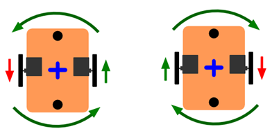
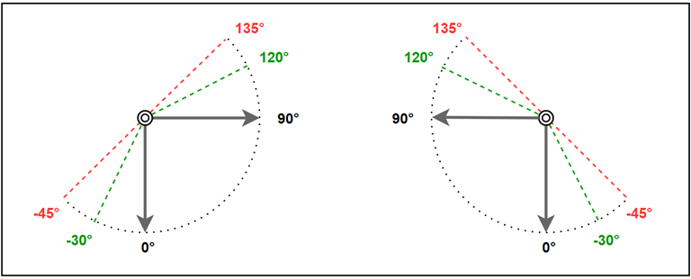
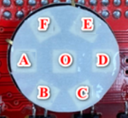
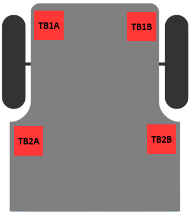
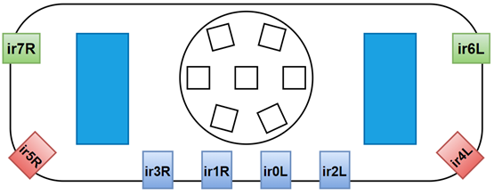

## Các hàm điều khiển Leanbot

[Tài liệu tham khảo Arduino](https://www.arduino.cc/reference/en/)

[Leanbot](#Leanbot)

- [Leanbot.begin](#Leanbotbegin)
- [LbDelay](#LbDelay)
- [LbMission.begin](#LbMissionbegin)

[Motion ](#Motion)

- [LbMotion.runLR](#LbMotionrunLR)
- [LbMotion.stopAndWait ](#LbMotionstopAndWait)
- [LbMotion.waitDistance ](#LbMotionwaitDistance)
- [LbMotion.waitDistanceMm ](#LbMotionwaitDistanceMm)
- [LbMotion.waitRotation ](#LbMotionwaitRotation)
- [LbMotion.waitRotationDeg ](#LbMotionwaitRotationDeg)
<!-- - [LbMotion.getDistance](#LbMotiongetDistance)
- [LbMotion.getDistanceMm](#LbMotiongetDistanceMm)
- [LbMotion.getRotation](#LbMotiongetRotation)
- [LbMotion.getRotationDeg](#LbMotiongetRotationDeg) -->

[Gripper ](#Gripper)

- [LbGripper.open ](#LbGripperopen)
- [LbGripper.close ](#LbGripperclose)
- [LbGripper.moveTo ](#LbGrippermoveTo)
- [LbGripper.moveToLR ](#LbGrippermoveToLR)
<!-- - [LbGripper.readL](#LbGripperreadL)
- [LbGripper.readR](#LbGripperreadR) -->

<!-- [Buzzer ](#Buzzer)

- [Leanbot.tone](#Leanbottone)
- [Leanbot.noTone](#LeanbotnoTone) -->

[RGB Leds ](#RGB-Leds)

- [LbRGB.show](#LbRGBshow)
- [LbRGB.clear](#LbRGBclear)
<!-- - [LbRGB[ledX]](#lbrgbledx) -->
- [LbRGB.fillColor](#LbRGBfillColor)

<!-- [Touch Sensors](#Touch-Sensors)

- [LbTouch.read](#LbTouchread)
- [LbTouch.readBits](#LbTouchreadBits)
- [LbTouch.onPress](#LbTouchonPress) -->

<!-- [Ultrasonic Sensor](#Ultrasonic-Sensor)

- [Leanbot.pingCm](#LeanbotpingCm)
- [Leanbot.pingMm](#LeanbotpingMm) -->

[IR Sensors](#IR-Sensors)

- [LbIRLine.read](#LbIRLineread)
- [LbIRLine.value](#LbIRLinevalue)
- [LbIRLine.print](#LbIRLineprint)
- [LbIRLine.displayOnRGB](#LbIRLinedisplayOnRGB)
- [LbIRLine.isBlackDetected](#LbIRLineisBlackDetected)
- [LbIRLine.doManualCalibration ](#LbIRLinedoManualCalibration)
- [LbIRArray.read](#LbIRArrayread)

<!-- [Laze Sensors](#Laze-Sensors)

- [LbLaze.begin](#LbLazebegin)
- [LbLaze.shoot](#LbLazeshoot) -->

[Color Detector](#Color-Detector)

- [Obj_detectColor](#obj_detectcolor)
<!-- - [LbColorDetector.detect](#LbColorDetectordetect)
- [LbColorDetector.printRGB](#LbColorDetectorprintRGB) -->

# Leanbot

## Leanbot.begin()

### Mô tả

Hàm khởi động Leanbot.

### Cú pháp

```
Leanbot.begin()
```

### Tham số

Không có

### Giá trị trả về

Không có

### Ví dụ

```
#include <Leanbot.h>

void setup() {
  Leanbot.begin();                // initialize Leanbot
}
```

### Chú ý

Hàm này cần được gọi trong hàm `setup()`.

[🔼 Trở về đầu trang](#Các-hàm-điều-khiển-Leanbot)

## LbDelay()

### Mô tả

Hàm này làm cho chương trình chờ cho đến khi hết thời gian trễ được chỉ định, sau đó xử lý dòng lệnh tiếp theo.
Trong khi đó, Leanbot vẫn tiếp tục chạy các hàm khác từ trước, ví dụ như cho Leanbot đi thẳng.

### Cú pháp

```
LbDelay(timeMs)
```

### Tham số

- `timeMs`: Thời gian trễ milli giây (1000 mili giây bằng 1 giây)
  - Đơn vị: ms
  - Khoảng giá trị: [0, 65535]
  - Kiểu dữ liệu: `unsigned int`

### Giá trị trả về

Không có

### Ví dụ

Cho Leanbot đi thẳng với vận tốc 400 trong 3 giây, rồi dừng lại

```
LbMotion.runLR(400, 400);    // let Leanbot move forward
LbDelay(3000);               // wait for 3 seconds (Leanbot keeps moving forward)
LbMotion.runLR(0, 0);        // stop Leanbot
```

### Chú ý

Thời gian trễ cao nhất là `65,535` mili giây (≈ 65.5 giây)

## LbMission.begin()

### Cú pháp

```
LbMission.begin()
```

### Mô tả

Leanbot sẽ chờ tín hiệu bắt đầu nhiệm vụ bằng cách yêu cầu người dùng chạm đồng thời vào hai nút `TB1A` và `TB1B` ở phía trước Leanbot. Trong thời gian này, chương trình sẽ bị chặn và không thực thi các lệnh khác.

Khi nhận được tín hiệu bắt đầu:

- Leanbot sẽ phát âm thanh đếm ngược `3` – `2` – `1`
- Sau đó bắt đầu nhiệm vụ và thực hiện các tác vụ đã được lập trình.

### Tham số

Không có

### Giá trị trả về

Không có

### Ví dụ

```
LbMission.begin();
```

[🔼 Trở về đầu trang](#Các-hàm-điều-khiển-Leanbot)

# Motion



## LbMotion.runLR()

### Mô tả

Hàm này đặt tốc độ và hướng quay cho bánh trái và bánh phải.
Tốc độ càng lớn, bánh xe quay càng nhanh.

### Cú pháp

```
LbMotion.runLR(vL, vR)
```

### Tham số

- `vL`: tốc độ bánh trái
- `vR`: tốc độ bánh phải
  - Đơn vị: bước mỗi giây
  - Phạm vi: [-2000, +2000]
  - Giá trị dương: quay tiến
  - Giá trị âm: quay lùi
  - Các loại dữ liệu cho phép: `int`

### Giá trị trả về

Không có

### Ví dụ

Leanbot di chuyển tiến với tốc độ 400.

```
LbMotion.runLR(400, 400);
```

Xem thêm:

- [runLR.ino](examples/LbMotion/runLR.ino)

[🔼 Trở về đầu trang](#Các-hàm-điều-khiển-Leanbot)

<!-- ## LbMotion.runLRrpm

### Mô tả
Hàm này đặt tốc độ (vòng quay mỗi phút) và hướng quay cho bánh trái và bánh phải.
Số vòng quay mỗi phút càng lớn, bánh xe quay càng nhanh.

### Cú pháp
```
LbMotion.runLRrpm(rpmL, rpmR)
```


### Tham số
- `rpmL`: tốc độ bánh trái
- `rpmR`: tốc độ bánh phải
  - Đơn vị: RPM - vòng quay mỗi phút
  - Phạm vi: [-60, +60]
  - Giá trị dương: quay tiến
  - Giá trị âm: quay lùi
  - Các loại dữ liệu cho phép: `int`

### Giá trị trả về
Không có

### Ví dụ
Ví dụ này làm cho Leanbot di chuyển tiến với tốc độ 30 vòng mỗi phút
```
LbMotion.runLRrpm(30, 30);
```
Xem thêm:
- [runLRrpm.ino](examples/LbMotion/runLRrpm.ino)

[🔼 Trở về đầu trang](#Các-hàm-điều-khiển-Leanbot)
 -->

## LbMotion.stopAndWait()

### Mô tả

Hàm này dừng Leanbot và đợi cho đến khi Leanbot hoàn toàn dừng hẳn.

### Cú pháp

```
LbMotion.stopAndWait()
```

### Tham số

Không có

### Giá trị trả về

Không có

### Ví dụ

```
LbMotion.stopAndWait();
```

[🔼 Trở về đầu trang](#Các-hàm-điều-khiển-Leanbot)

<!-- ## LbMotion.stopAndWait

### Mô tả
Hàm này dừng Leanbot và đợi cho đến khi Leanbot giảm tốc hoàn toàn và dừng hẳn.

### Cú pháp

```
isStop = LbMotion.isStop()
```

### Tham số
Không có

### Giá trị trả về
- `true`: Leanbot has stopped
- `false`: Leanbot is moving
- Data type: `bool`

### Ví dụ
```
bool isStop = LbMotion.isStop();
```

[🔼 Trở về đầu trang](#Các-hàm-điều-khiển-Leanbot)

## LbMotion.isMoving

### Mô tả
This function checks if Leanbot is moving or not.

### Cú pháp
```
isStop = LbMotion.isMoving()
```

### Tham số
Không có

### Giá trị trả về
- `true`: Leanbot is moving
- `false`: Leanbot has stopped
- Data type: `bool`

### Ví dụ
```
bool isMoving = LbMotion.isMoving();
```

[🔼 Trở về đầu trang](#Các-hàm-điều-khiển-Leanbot)
&nbsp; -->

---

## LbMotion.waitDistance()

### Mô tả

Chương trình sẽ chờ cho đến khi Leanbot đã di chuyển một khoảng cách cho trước rồi thực hiện dòng lệnh tiếp theo.

### Cú pháp

```
LbMotion.waitDistance(distanceStep)
```

### Tham số

- `distanceStep`: Khoảng cách Leanbot di chuyển
  - Đơn vị: bước
  - Các loại dữ liệu cho phép: `long`

### Giá trị trả về

Không có

### Ví dụ

```
LbMotion.runLR(400, 400);       // let Leanbot move forward
LbMotion.waitDistance(1500);    // wait for Leanbot to advance 1500 steps
```

Xem thêm:

- [waitDistance.ino](examples/LbMotion/waitDistance.ino)

[🔼 Trở về đầu trang](#Các-hàm-điều-khiển-Leanbot)

## LbMotion.waitDistanceMm()

### Mô tả

Chương trình đợi cho đến khi Leanbot di chuyển được khoảng cách (xấp xỉ) tính bằng mm sau đó thực hiện dòng lệnh tiếp theo.

### Cú pháp

```
LbMotion.waitDistanceMm(distanceMm)
```

### Tham số

- `distanceMm`: Khoảng cách Leanbot di chuyển tính bằng mm
  - Đơn vị: mm
  - Các loại dữ liệu cho phép: `int`

### Giá trị trả về

Không có

### Ví dụ

```
LbMotion.runLR(400, 400);       // let Leanbot move forward
LbMotion.waitDistanceMm(150);  // wait for Leanbot to advance 150mm = 15cm
```

Xem thêm:

- [waitDistanceMm.ino](examples/LbMotion/waitDistanceMm.ino)

[🔼 Trở về đầu trang](#Các-hàm-điều-khiển-Leanbot)

<!-- ## LbMotion.waitRotation()

### Mô tả

Chương trình sẽ chờ cho đến khi Leanbot đã quay được một góc cho trước rồi thực hiện dòng lệnh tiếp theo

### Cú pháp
```
LbMotion.waitRotation(rotationStep)
```

### Tham số
- `rotationStep`: Góc quay của Leanbot
- Đơn vị: bước
- Các loại dữ liệu cho phép: `long`

### Giá trị trả về
Không có

### Ví dụ

```
LbMotion.runLR(+400, -400);      // let Leanbot rotate
LbMotion.waitRotation(1500);     // wait for rotating 1500 steps
```
Xem thêm:
- [waitRotation.ino](examples/LbMotion/waitRotation.ino)

### Chú ý
Cần phải thực nghiệm và điều chỉnh góc quay để tìm ra giá trị bước tương ứng với góc quay mong muốn
- Giá trị bước sẽ khác nhau đối với mỗi Leanbot, tốc độ và bề mặt chuyển động
- Ví dụ: với tốc độ 500 và giá trị bước là 1750, Leanbot sẽ quay một góc khoảng 90°

[🔼 Trở về đầu trang](#Các-hàm-điều-khiển-Leanbot) -->

## LbMotion.waitRotationDeg()

### Mô tả

Chương trình đợi cho đến khi Leanbot xoay được (xấp xỉ) góc độ mong muốn sau đó thực hiện dòng lệnh tiếp theo.

### Cú pháp

```
LbMotion.waitRotationDeg(rotationDeg)
```

### Tham số

- `rotationDeg`: góc Leanbot sẽ quay
  - Đơn vị: độ
  - Các loại dữ liệu cho phép: `int`

### Giá trị trả về

Không có

### Ví dụ

```
LbMotion.runLR(+500, -500);        // let Leanbot rotate right
LbMotion.waitRotationDeg(180);     // wait for Leanbot to rotate approximately 180°
```

[🔼 Trở về đầu trang](#Các-hàm-điều-khiển-Leanbot)

<!-- ## LbMotion.getDistance()

### Mô tả

Hàm này trả về giá trị bước mà Leanbot đã di chuyển

### Cú pháp

```
long distance = LbMotion.getDistance()
```

### Tham số

Không có

### Giá trị trả về

Giá trị bước mà Leanbot đã di chuyển

- Đơn vị: bước
- Loại dữ liệu: `long`

### Ví dụ

```
long distance = LbMotion.getDistance();
```

[🔼 Trở về đầu trang](#Các-hàm-điều-khiển-Leanbot) -->

<!-- ## LbMotion.getDistanceMm()

### Mô tả

Hàm này trả về giá trị khoảng cách theo mm mà Leanbot đã di chuyển

### Cú pháp
```
long distance = LbMotion.getDistanceMm()
```

### Tham số
Không có

### Giá trị trả về
Khoảng cách Leanbot đã di chuyển
- Đơn vị: mm
- Loại dữ liệu: `long`

### Ví dụ
```
long distanceMm = LbMotion.getDistanceMm();
```

[🔼 Trở về đầu trang](#Các-hàm-điều-khiển-Leanbot)

## LbMotion.getRotation()

### Mô tả
Hàm này trả về giá trị góc mà Leanbot đã quay theo đơn vị bước

### Cú pháp
```
long rotation = LbMotion.getRotation()
```

### Tham số
Không có

### Giá trị trả về
Giá trị góc đã quay của Leanbot
- Đơn vị: bước
- Loại giá trị: `long`

### Ví dụ
```
long rotation = LbMotion.getRotation();
```

[🔼 Trở về đầu trang](#Các-hàm-điều-khiển-Leanbot)

## LbMotion.getRotationDeg()

### Mô tả
Hàm này trả về giá trị góc mà Leanbot đã quay theo đơn vị độ

### Cú pháp
```
long rotationDegree = LbMotion.getRotationDeg()
```

### Tham số
Không có

### Giá trị trả về
Giá trị góc đã quay của Leanbot
- Đơn vị: độ
- Loại dữ liệu: `long`

### Ví dụ
```
long rotationDegree = LbMotion.getRotationDeg();
```

[🔼 Trở về đầu trang](#Các-hàm-điều-khiển-Leanbot) -->

# Gripper



## LbGripper.open()

### Mô tả

Hàm này di chuyển các cánh tay kẹp đến vị trí mở (cả hai cánh tay ở vị trí 0 độ - vuông góc với bề mặt)

### Cú pháp

```
LbGripper.open()
```

### Tham số

Không có

### Giá trị trả về

Không có

### Ví dụ

```
LbGripper.open();
```

Xem thêm:

- [GripperOpenClose.ino](examples/LbGripper/GripperOpenClose.ino)

[🔼 Trở về đầu trang](#Các-hàm-điều-khiển-Leanbot)

## LbGripper.close()

### Mô tả

Hàm này di chuyển cả hai cánh tay kẹp đến vị trí đóng (cả hai cánh tay ở vị trí 90 độ - song song với bề mặt)

### Cú pháp

```
LbGripper.close()
```

### Tham số

Không có

### Giá trị trả về

Không có

### Ví dụ

```
LbGripper.close();
```

Xem thêm:

- [GripperOpenClose.ino](examples/LbGripper/GripperOpenClose.ino)

[🔼 Trở về đầu trang](#Các-hàm-điều-khiển-Leanbot)

## LbGripper.moveTo()

### Mô tả

Hàm này di chuyển cả hai cánh tay kẹp đến cùng một góc mong muốn.

### Cú pháp

```
LbGripper.moveTo(toAngle)
```

### Tham số

- `toAngle`: góc cần di chuyển đến
  - Đơn vị: độ (góc)
  - Phạm vi: [-30, +120]
  - Các kiểu dữ liệu cho phép: `int`

### Giá trị trả về

Không có

### Ví dụ

Ví dụ di chuyển cả hai cánh tay kẹp đến vị trí 45°

```
LbGripper.moveTo(45);
```

Xem thêm:

- [GripperMoveTo.ino](examples/LbGripper/GripperMoveTo.ino)

[🔼 Trở về đầu trang](#Các-hàm-điều-khiển-Leanbot)

## LbGripper.moveToLR()

### Mô tả

Hàm này di chuyển cả hai cánh tay kẹp đến các góc mong muốn cho một khoảng thời gian nhất định.

### Cú pháp

```
LbGripper.moveToLR(toAngleL, toAngleR, timeMs)
```

### Tham số

- `toAngleL`: góc của cánh tay kẹp bên trái cần di chuyển đến
- `toAngleR`: góc của cánh tay kẹp bên phải cần di chuyển đến
  - Đơn vị: độ (góc)
  - Phạm vi: [-30, +120]
  - Các kiểu dữ liệu cho phép: `int`

- `timeMs`: thời gian tính bằng mili giây để di chuyển cả hai cánh tay kẹp đến các góc mục tiêu
  - Các kiểu dữ liệu cho phép: `int`

### Giá trị trả về

Không có

### Ví dụ

Ví dụ di chuyển cánh tay kẹp bên trái đến vị trí 30° và cánh tay kẹp bên phải đến vị trí 60° trong 1.5 giây

```
LbGripper.moveToLR(30, 60, 1500);
```

Xem thêm:

- [GripperMoveToLR.ino](examples/LbGripper/GripperMoveToLR.ino)

[🔼 Trở về đầu trang](#Các-hàm-điều-khiển-Leanbot)

<!-- ## LbGripper.readL()

### Mô tả

Hàm này trả về góc hiện tại (tính bằng độ) của cánh tay kẹp bên trái.

### Cú pháp

```
LbGripper.readL()
```

### Tham số

Không có

### Giá trị trả về

Góc hiện tại (tính bằng độ) của cánh tay kẹp bên trái

- Đơn vị: độ (góc)
- Phạm vi: [-30, +120]
- Kiểu dữ liệu: `int`

### Ví dụ

```
int angleL = LbGripper.readL();
```

[🔼 Trở về đầu trang](#Các-hàm-điều-khiển-Leanbot)

## LbGripper.readR()

### Mô tả

Hàm này trả về góc hiện tại (tính bằng độ) của cánh tay kẹp bên phải.

### Cú pháp

```
LbGripper.readR()
```

### Tham số

Không có

### Giá trị trả về

Góc hiện tại (tính bằng độ) của cánh tay kẹp bên phải

- Đơn vị: độ (góc)
- Phạm vi: [-30, +120]
- Kiểu dữ liệu: `int`

### Ví dụ

```
int angleR = LbGripper.readR();
```

[🔼 Trở về đầu trang](#Các-hàm-điều-khiển-Leanbot) -->

<!-- # Buzzer

## Leanbot.tone()

### Mô tả

Hàm này phát âm thanh với tần số được chỉ định trong một khoảng thời gian.

- Trong khi phát âm thanh, Leanbot tiếp tục xử lý dòng mã tiếp theo
- Âm thanh sẽ tự động dừng lại sau khoảng thời gian, hoặc gọi hàm [Leanbot.noTone](#Leanbot.noTone)

### Cú pháp

```
Leanbot.tone(frequency, duration)
```

### Tham số

- frequency: tần số của âm thanh tính bằng Hertz (Hz)
  - Đơn vị: Hertz (Hz)
  - Kiểu dữ liệu cho phép: `unsigned int`

- duration: (tùy chọn) khoảng thời gian của âm thanh tính bằng mili giây
  - Đơn vị: ms
  - Kiểu dữ liệu cho phép: `unsigned int`

### Giá trị trả về

Không có

### Ví dụ

Phát âm thanh với tần số 1000 Hz trong 1.5 giây

```
Leanbot.tone(1000, 1500);
```

Xem thêm:

- [tone.ino](examples/Buzzer/tone.ino)
- [toneDuration.ino](examples/Buzzer/toneDuration.ino)

### Chú ý

Hàm này là không chặn (non-blocking), nghĩa là ngay cả khi bạn cung cấp tham số thời gian, việc thực thi mã sẽ tiếp tục ngay lập tức ngay cả khi âm thanh chưa phát xong.

[🔼 Trở về đầu trang](#Các-hàm-điều-khiển-Leanbot)

## Leanbot.noTone()

### Mô tả

Hàm này dừng âm thanh được phát bởi [Leanbot.tone](#Leanbot.tone)

### Cú pháp

```
Leanbot.noTone()
```

### Tham số

Không có

### Giá trị trả về

Không có

### Ví dụ

```
Leanbot.noTone();
```

Xem thêm:

- [noTone.ino](examples/Buzzer/noTone.ino)

[🔼 Trở về đầu trang](#Các-hàm-điều-khiển-Leanbot) -->

# RGB Leds



- Leanbot có 7 đèn LED RGB: `ledA`, `ledB`, `ledC`, `ledD`, `ledE`, `ledF` và `ledO`

## Mã màu RGB

Có 3 cú pháp khác nhau để biểu diễn một màu RGB:

1. Tên màu: `CRGB::ColorName`

- Ví dụ: `CRGB::Red`, `CRGB::Green`, `CRGB::Blue`
- Xem thêm: [https://github.com/FastLED/FastLED/wiki/Pixel-reference#predefined-colors-list](https://github.com/FastLED/FastLED/wiki/Pixel-reference#predefined-colors-list)

2. Mã thập phân: `CRGB(red, green, blue)`

- Mỗi tham số (red, green và blue) định nghĩa cường độ của màu với giá trị từ 0 đến 255
- Ví dụ:
  - `CRGB(255, 0, 0)` là màu đỏ, vì red được đặt ở giá trị cao nhất (255), và hai giá trị còn lại (green và blue) được đặt ở 0
  - `CRGB(0, 255, 0)` là màu xanh lá cây, vì green được đặt ở giá trị cao nhất (255), và hai giá trị còn lại (red và blue) được đặt ở 0
  - Để hiển thị màu đen, đặt tất cả các tham số về 0: `CRGB(0, 0, 0)`
  - Để hiển thị màu trắng, đặt tất cả các tham số về 255: `CRGB(255, 255, 255)`
- Xem thêm: [https://www.w3schools.com/colors/colors_picker.asp](https://www.w3schools.com/colors/colors_picker.asp)

3. Mã hex: `0xRRGGBB`

- Nối liền 3 giá trị hex của red, green và blue lại với nhau
- Ví dụ: `0xFF0000` (đỏ), `0x00FF00` (xanh lá cây), `0x0000FF` (xanh dương)

## LbRGB.show()

### Mô tả

Hàm này hiển thị tất cả các đèn LED.

### Cú pháp

```
LbRGB.show()
```

### Tham số

Không có

### Giá trị trả về

Không có

### Ví dụ

```
LbRGB.show();
```

### Chú ý

Hàm này phải được gọi sau khi cập nhật màu của các đèn LED.

[🔼 Trở về đầu trang](#Các-hàm-điều-khiển-Leanbot)

## LbRGB.clear()

### Mô tả

Hàm này xóa tất cả các đèn LED về màu đen.

### Cú pháp

```
LbRGB.clear()
```

### Tham số

Không có

### Giá trị trả về

Không có

### Ví dụ

```
LbRGB.clear();
LbRGB.show();
```

[🔼 Trở về đầu trang](#Các-hàm-điều-khiển-Leanbot)

<!-- ## LbRGB[ledX]

### Mô tả

Hàm này đặt một đèn LED đến màu RGB được cho.

### Cú pháp

```
LbRGB[ledX] = color
```

### Tham số

- `ledX`: đèn LED cần được đặt màu
- `color`: mã màu [RGB](#RGB-color-code)

### Giá trị trả về

Không có

### Ví dụ

```
LbRGB[ledA] = CRGB::Red;              // set `ledA` to red
LbRGB[ledO] = CRGB(0, 255, 0);        // set `ledO` to green
LbRGB[ledD] = 0x0000FF;               // set `ledD` to blue
LbRGB.show();                         // show all Leds to diplay
```

Xem thêm:

- [setColor.ino](examples/LbRGB/setColor.ino)

### Chú ý

Hàm này chỉ cập nhật giá trị màu của một đèn LED

- Bạn phải gọi [LbRGB.show](#LbRGB.show) để thực sự hiển thị các màu mới của đèn LED

[🔼 Trở về đầu trang](#Các-hàm-điều-khiển-Leanbot) -->

## LbRGB.fillColor()

### Mô tả

Hàm này tô màu (tập hợp các đèn LED) với màu RGB được cho.

### Cú pháp

```
LbRGB.fillColor(color, shape)
```

### Tham số

- `color`: mã màu [RGB](#RGB-color-code)

- `shape`: tập hợp các đèn LED cần đặt màu
- Nếu để trống `shape` thì tự hiểu là tô tất cả các đèn
- Các loại dữ liệu được phép: `byte`

### Giá trị trả về

Không có

### Ví dụ

Ví dụ đặt màu xanh lá cây cho 4 đèn LED A, B, C và D (một hình mặt cười)

```
byte LbSmiley = BITMAP(ledA, ledB, ledC, ledD);   // create smiley shape
LbRGB.fillColor(CRGB::Green, LbSmiley);           // fill green color
LbRGB.show();                                     // show all Leds to diplay
```

Ví dụ đặt màu xanh lá cây cho tất cả đèn

```
LbRGB.fillColor(CRGB::Green);           // fill green color
LbRGB.show();                                     // show all Leds to diplay
```

Xem thêm:

- [fillColor.ino](examples/LbRGB/fillColor.ino)

[🔼 Trở về đầu trang](#Các-hàm-điều-khiển-Leanbot)

# Touch Sensors



- Leanbot có 4 cảm biến chạm: `TB1A`, `TB1B`, `TB2A` và `TB2B`

## LbTouch.read()

### Mô tả

Hàm này đọc trạng thái của cảm biến chạm được chỉ định.

### Cú pháp

```
value = LbTouch.read(tbX)
```

### Tham số

`tbX`: cảm biến chạm cần đọc. Các lựa chọn hợp lệ là:

- TB1A
- TB1B
- TB2A
- TB2B

### Giá trị trả về

Trạng thái của cảm biến chạm

- Giá trị `0`: cảm biến không bị chạm
- Giá trị `1`: cảm biến đang bị chạm
- Loại dữ liệu: `byte`

### Ví dụ

Ví dụ đọc trạng thái của các cảm biến `TB1A` và `TB2A`

```
byte value1A = LbTouch.read(TB1A);
byte value2A = LbTouch.read(TB2A);
```

Xem thêm:

- [ledControl.ino](examples/LbTouch/ledControl.ino)
- [wheelControl.ino](examples/LbTouch/wheelControl.ino)

### Chú ý

Nhiều cảm biến có thể được kết hợp và đọc cùng một lúc.

```
LbTouch.read(TB1A | TB1B)
```

[🔼 Trở về đầu trang](#Các-hàm-điều-khiển-Leanbot)

## LbTouch.readBits()

### Mô tả

Hàm này đọc trạng thái của tất cả 4 cảm biến chạm.

### Cú pháp

```
touchBits = LbTouch.readBits()
```

### Tham số

- Không có

### Giá trị trả về

Trạng thái nhị phân của 4 cảm biến chạm

- Giá trị `0`: cảm biến không bị chạm
- Giá trị `1`: cảm biến đang bị chạm
- Loại dữ liệu: `byte`

### Ví dụ

```
byte touchBits = LbTouch.readBits();
```

Xem thêm:

- [readBits.ino](examples/LbTouch/readBits.ino)

[🔼 Trở về đầu trang](#Các-hàm-điều-khiển-Leanbot)

## LbTouch.onPress()

### Mô tả

Hàm này đọc sự kiện chạm của cảm biến chạm được chỉ định.

### Cú pháp

```
isOnPress = LbTouch.onPress(tbX)
```

### Tham số

- `tbX`: cảm biến chạm cần đọc

### Giá trị trả về

Sự kiện chạm của cảm biến chạm

- Giá trị `true`: cảm biến không vừa mới bị chạm, hoặc là được thả ra hoặc đang giữ
- Giá trị `false`: cảm biến vừa mới bị chạm
- Loại dữ liệu: `bool`

### Ví dụ

Ví dụ đọc trạng thái chạm của cảm biến `TB1A`

```
bool value1A = LbTouch.onPress(TB1A);
```

Xem thêm:

- [onPress.ino](examples/LbTouch/onPress.ino)

### Chú ý

Nhiều cảm biến có thể được kết hợp và đọc cùng một lúc.

```
LbTouch.onPress(TB1A | TB1B)
```

[🔼 Trở về đầu trang](#Các-hàm-điều-khiển-Leanbot)

<!-- # Ultrasonic Sensor

### Chú ý

Cảm biến siêu âm có thể được kích hoạt nhanh nhất mỗi 50 ms, hoặc 20 lần mỗi giây

- Bạn nên đợi 50 ms trước khi gửi tín hiệu ping tiếp theo
- Điều này đảm bảo tiếng **bíp** siêu âm đã tắt và sẽ không gây ra phản hồi sai trong lần đo tiếp theo

## Leanbot.pingCm()

### Mô tả

Hàm này gửi một tín hiệu ping và trả về khoảng cách phía trước được đo bằng đơn vị centimet.

### Cú pháp

```
distanceCm = Leanbot.pingCm()
```

### Tham số

Không có

### Giá trị trả về

Khoảng cách phía trước được đo bằng đơn vị centimet

- Đơn vị: cm
- Loại dữ liệu: `unsigned int`

### Ví dụ

```
unsigned int distanceCm = Leanbot.pingCm();
```

Xem thêm:

- [pingCm.ino](examples/Ping/pingCm.ino)

### Chú ý

Khoảng cách tối đa của cảm biến là 300 cm, ngoài khoảng cách này, hàm sẽ trả về 1,000 cm.

[🔼 Trở về đầu trang](#Các-hàm-điều-khiển-Leanbot)

## Leanbot.pingMm()

### Mô tả

Hàm này gửi một tín hiệu ping và trả về khoảng cách phía trước được đo bằng đơn vị milimet.

### Cú pháp

```
distanceMm = Leanbot.pingMm()
```

### Tham số

Không có

### Giá trị trả về

Khoảng cách phía trước được đo bằng đơn vị milimet

- Đơn vị: mm
- Loại dữ liệu: `unsigned int`

### Ví dụ

```
unsigned int distanceMm = Leanbot.pingMm();
```

### Chú ý

Khoảng cách tối đa của cảm biến là `3,000 mm`, ngoài khoảng cách này, hàm sẽ trả về `10,000 mm`

[🔼 Trở về đầu trang](#Các-hàm-điều-khiển-Leanbot) -->

# IR Sensors



- Leanbot có 8 cảm biến hồng ngoại với các mục đích khác nhau:

| Chức năng             |         Cảm biến          |
| --------------------- | :-----------------------: |
| Phát hiện đường       | ir3R - ir1R - ir0L - ir2L |
| Phát hiện mép bàn     |        ir5R - ir4L        |
| Phát hiện chướng ngại |        ir7R - ir6L        |

## LbIRLine.read()

### Mô tả

Hàm này đọc giá trị của 4 cảm biến phát hiện đường (ir3R - ir1R - ir0L - ir2L) . Dùng để kiểm tra vị trí của đường đen so với Leanbot.

### Cú pháp

```
lineState = LbIRLine.read()
```

### Tham số

Không có

### Giá trị trả về

Trạng thái nhị phân của 4 cảm biến phát hiện đường

- Giá trị `0`: cảm biến nằm trên bề mặt trắng
- Giá trị `1`: cảm biến nằm trên đường đen
- Loại dữ liệu: `byte`

### Ví dụ

```
byte lineState = LbIRLine.read();
```

Xem thêm:

- [readLineState.ino](examples/LbIRLine/readLineState.ino)
- [followLine.ino](examples/LbIRLine/followLine.ino)

[🔼 Trở về đầu trang](#Các-hàm-điều-khiển-Leanbot)

## LbIRLine.value()

### Mô tả

Hàm này trả về giá trị của 4 cảm biến phát hiện đường được đọc trước đó.

### Cú pháp

```
LbIRLine.value()
```

### Tham số

Không có

### Giá trị trả về

Giá trị của 4 cảm biến đường

- Loại dữ liệu: `byte`

### Ví dụ

```
byte lineValue = LbIRLine.value();
```

[🔼 Trở về đầu trang](#Các-hàm-điều-khiển-Leanbot)

## LbIRLine.print()

### Mô tả

Hàm này gửi giá trị của 4 cảm biến phát hiện đường (được đọc trước đó) tới máy tính.

### Cú pháp

```
LbIRLine.print()
```

### Tham số

Không có

### Giá trị trả về

Không có

### Ví dụ

```
LbIRLine.print();
```

[🔼 Trở về đầu trang](#Các-hàm-điều-khiển-Leanbot)

## LbIRLine.displayOnRGB()

### Mô tả

Hàm này hiển thị kết quả của 4 cảm biến phát hiện đường trên các đèn LED RGB với màu sắc.

- Nếu cảm biến nào đang ở trên đường đen, đèn LED RGB tương ứng sẽ sáng lên

### Cú pháp

```
LbIRLine.displayOnRGB(color)
```

### Tham số

- `color`: mã màu [RGB](#RGB-color-code)

### Giá trị trả về

Không có

### Ví dụ

```
LbIRLine.read();                     // update line state
LbIRLine.displayOnRGB(CRGB::Blue);   // display result on Leds
```

[🔼 Trở về đầu trang](#Các-hàm-điều-khiển-Leanbot)

## LbIRLine.isBlackDetected()

### Mô tả

Hàm này kiểm tra xem một trong 4 cảm biến phát hiện đường có đang ở trên đường đen không.

### Cú pháp

```
LbIRLine.isBlackDetected()
```

### Tham số

Không có

### Giá trị trả về

- `true` : cảm biến phát hiện đường đang ở trên đường đen
- `false`: cảm biến phát hiện đường KHÔNG ở trên đường đen
- Loại dữ liệu: `bool`

### Ví dụ

Ví dụ cho Leanbot di chuyển về phía trước cho đến khi kết thúc đường đen

```
LbMotion.runLR(400, 400);                // move forward
while ( LbIRLine.isBlackDetected() );    // keep moving as long as Leanbot can see the black line
LbMotion.stopAndWait();                  // stop
```

[🔼 Trở về đầu trang](#Các-hàm-điều-khiển-Leanbot)

## LbIRLine.doManualCalibration()

### Mô tả

Hàm này thực hiện hiệu chuẩn mức ánh sáng 3 bước với nút cảm ứng.

### Cú pháp

```
LbIRLine.doManualCalibration(tbX)
```

### Tham số

- `tbX`: cảm biến chạm được sử dụng để thực hiện lấy mẫu đen/trắng
  - Leanbot có 4 cảm biến chạm: `TB1A`, `TB1B`, `TB2A` và `TB2B`

### Giá trị trả về

Không có

### Ví dụ

```
LbIRLine.doManualCalibration(TB1A);
```

Xem thêm:

- [lineCalibration.ino](examples/LbIRLine/lineCalibration.ino)
- [calibrationThenFollowLine.ino](examples/LbIRLine/calibrationThenFollowLine.ino)

### Chú ý

Nên thực hiện bước này trước khi bắt đầu nhiệm vụ hoặc khi có sự thay đổi về ánh sáng môi trường hoặc bề mặt di chuyển.

[🔼 Trở về đầu trang](#Các-hàm-điều-khiển-Leanbot)

## LbIRArray.read()

### Mô tả

Hàm này đọc giá trị của cảm biến được chỉ định.
Bề mặt càng tối, giá trị cảm biến càng cao.

### Cú pháp

```
LbIRArray.read(irX)
```

### Tham số

- `irX`: cảm biến cần đọc

### Giá trị trả về

Giá trị của cảm biến: 0 - 768

- Loại dữ liệu: `int`

### Ví dụ

Ví dụ đọc giá trị của cảm biến `ir0L` và gửi kết quả tới máy tính

```
int value = LbIRArray.read(ir0L);    // read the sensor value
Serial.println(value);               // transfer the results to the computer
```

[🔼 Trở về đầu trang](#Các-hàm-điều-khiển-Leanbot)

<!-- # Laze Sensors

Trước khi sử dụng `Laze Sensors` hãy khai báo:

```
class cLbLaze {
  public:
    void begin();
    void shoot();
};

void cLbLaze::begin() {
  pinMode(13, OUTPUT);
}

void cLbLaze::shoot() {
  Serial.println("shoot");
  digitalWrite(13, HIGH);
  delay(2000);
  digitalWrite(13, LOW);
}

cLbLaze LbLaze;
```

## LbLaze.begin()

### Mô tả

Hàm `LbLaze.begin()` khởi tạo cảm biến laze của Leanbot, thiết lập chân điều khiển laze làm đầu ra (`OUTPUT`).
Hàm này cần được gọi trong `setup()` trước khi sử dụng `LbLaze.shoot()`.

### Cú pháp

```
LbLaze.begin();
```

### Tham số

Không có

### Giá trị trả về

Không có

## LbLaze.shoot()

### Mô tả

Hàm `LbLaze.shoot()` kích hoạt các cảm biến laze của Leanbot, bật tia laze trong 2 giây rồi tắt.

### Cú pháp

```
LbLaze.shoot()
```

### Tham số

Không có

### Giá trị trả về

Không có

### Ví dụ

- [Laze.ino](examples/Laze/Laze.ino)

[🔼 Trở về đầu trang](#Các-hàm-điều-khiển-Leanbot) -->

# Color Detector

<!-- Trước khi sử dụng `Color Detector` hãy khai báo:

```
#include <Arduino_APDS9960.h>

class cLbColorDetector {
  public:
    void detect();
    void printRGB();

  private:
    int objRed, objGreen, objBlue;
};

void cLbColorDetector::detect() {
  int originalBrightness = LbRGB.getBrightness();
  LbRGB.setBrightness(255);

  int rr, gg, bb;

  LbRGB.fillColor(0xFF00FF);
  LbRGB.show();

  while (APDS.colorAvailable() == 0);
  APDS.readColor(rr, gg, bb);
  int r1 = rr;
  int b1 = bb;

  LbRGB.fillColor(0x00FF00);
  LbRGB.show();

  while (APDS.colorAvailable() == 0);
  APDS.readColor(rr, gg, bb);
  int g1 = gg;

  LbRGB.fillColor(0x000000);
  LbRGB.show();

  while (APDS.colorAvailable() == 0);
  APDS.readColor(rr, gg, bb);

  objRed   = (r1 - rr) * 2;
  objGreen = (g1 - gg) * 2;
  objBlue  = (b1 - bb) * 1;

  LbRGB.setBrightness(originalBrightness);
}

void cLbColorDetector::printRGB() {
  Serial.print("RGB: ");
  Serial.print(objRed);
  Serial.print(" ");
  Serial.print(objGreen);
  Serial.print(" ");
  Serial.print(objBlue);
  Serial.println();
}

cLbColorDetector LbColorDetector;
```

- Và trong `setup()`, hãy gọi để kiểm tra cảm biến:

```
if (APDS.begin()) {
  Serial.println("Init APDS-9960 ok.");
} else {
  Serial.println("Init APDS-9960 error.");
  while (1);
}
``` -->

<!-- ## LbColorDetector.detect()

### Mô tả

Hàm `LbColorDetector.detect()` phát hiện màu của vật thể bằng cách sử dụng cảm biến APDS-9960.
Hàm này thay đổi màu đèn LED để xác định giá trị RGB của vật thể và lưu trữ vào biến nội bộ.

**Lưu ý:** Cảm biến APDS-9960 cần được khởi tạo trước khi gọi hàm này.

Khoảng cách để xác định đúng là < 5 cm.

### Cú pháp

```
LbColorDetector.detect();
```

### Tham số

Không có

### Giá trị trả về

Không có

## LbColorDetector.printRGB()

### Mô tả

Hàm `LbColorDetector.printRGB()` in ra giá trị RGB của vật thể được phát hiện bởi cảm biến màu.
Các giá trị này đã được tính toán trong hàm `LbColorDetector.detect()`.

### Cú pháp

```
LbColorDetector.printRGB();
```

### Tham số

Không có

### Giá trị trả về

Không có

### Ví dụ

```
LbColorDetector.detect();
LbColorDetector.printRGB();
```

Kết quả mong đợi trên Serial Monitor

```
RGB: 120 85 60
```

### Xem thêm

- [ColorDetector.ino](examples/APDS/ColorDetector.ino)

[🔼 Trở về đầu trang](#Các-hàm-điều-khiển-Leanbot) -->

# Obj_detectColor

### 1. Giới thiệu

Hàm `Obj_detectColor()` được sử dụng để nhận diện màu sắc của vật thể thông qua cảm biến màu APDS-9960 trên Leanbot.

Hàm có khả năng phân biệt 4 màu cơ bản:

- **Red:** Màu đỏ
- **Green:** Màu xanh lá
- **Blue:** Màu xanh dương
- **Purple:** Màu tím

Sau khi nhận diện, Leanbot sẽ hiển thị màu tương ứng trên đèn LED RGB và trả về tên màu dưới dạng chuỗi `String`.

### 2. Cú pháp

```cpp
String mau = Obj_detectColor();
```

**Tham số:** Không có.

**Giá trị trả về:** Chuỗi `String` biểu thị màu được nhận diện: `"Red"`, `"Green"`, `"Blue"` hoặc `"Purple"`.

### 3. Ví dụ sử dụng

```cpp
#include <Leanbot.h>
#include <Arduino_APDS9960.h>

void setup() {
    Leanbot.begin();
    APDS.begin();
}

void loop() {
    String mau = Obj_detectColor();

    if (mau == "Red") {
        LbGripper.moveTo(-30);
    }
    else if (mau == "Blue") {
        LbGripper.moveTo(60);
    }

    LbDelay(500);
}
```

### 4. Nguyên lý hoạt động

Khi gọi `Obj_detectColor()`, Leanbot thực hiện các bước:

1. Đọc giá trị RGB của vật thể bằng cảm biến APDS-9960.
2. Phân tích và so sánh các thành phần màu RGB để xác định màu sắc.
3. Hiển thị màu nhận diện được trên đèn LED RGB.
4. Trả về tên màu để chương trình thực hiện các hành động tương ứng.

[🔼 Trở về đầu trang](#Các-hàm-điều-khiển-Leanbot)
